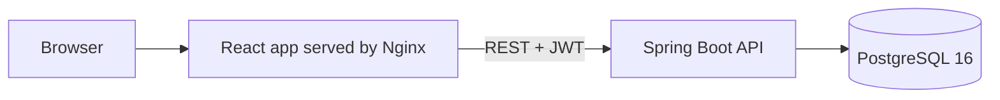
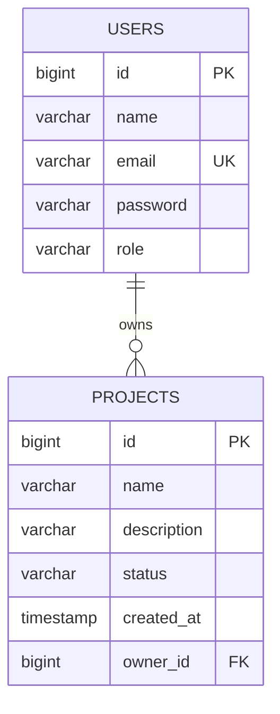

# CloudOps Platform

A full-stack project management system with user accounts, role-based access and a statistics dashboard. Built with React, Spring Boot and PostgreSQL, containerized with Docker Compose, and built and checked by a GitHub Actions pipeline.

<!-- Add a screenshot: put the file at docs/dashboard.png, then remove this comment markup and keep the line below.

-->

## Features

- Registration and login with JWT authentication
- Role-based authorization (`USER` and `ADMIN`)
- Project CRUD (create, read, update, delete) with statuses `ACTIVE`, `COMPLETED`, `ON_HOLD`
- Each user sees only their own projects; admins see everything
- Dashboard with total projects, counts per status and the most recent projects
- Validation errors and failures return clear JSON responses with proper HTTP status codes

## Tech stack

| Layer | Technology |
|---|---|
| Frontend | React (Vite), React Router, Axios |
| Backend | Java, Spring Boot 4, Spring Security, Spring Data JPA (Hibernate) |
| Database | PostgreSQL 16 |
| Auth | JWT (jjwt), BCrypt password hashing |
| Containers | Docker, Docker Compose, Nginx (serves the built frontend) |
| CI/CD | GitHub Actions, GitHub Container Registry |
| API testing | Postman |

## Architecture



Backend layers: `controller` (HTTP) → `service` (business rules and ownership checks) → `repository` (database). Request and response shapes live in `dto`, so entities, and password hashes, never leave the API.

## Database schema



## API

All endpoints except `/api/auth/**` require the header `Authorization: Bearer <token>`.

| Method | Path | Description |
|---|---|---|
| POST | `/api/auth/register` | Create an account and return a token |
| POST | `/api/auth/login` | Log in and return a token |
| GET | `/api/projects` | List projects (own projects, or all for admins) |
| POST | `/api/projects` | Create a project |
| GET | `/api/projects/{id}` | Get one project |
| PUT | `/api/projects/{id}` | Update a project |
| DELETE | `/api/projects/{id}` | Delete a project |
| GET | `/api/dashboard/stats` | Totals, counts by status and recent projects |

Status codes used: `200`, `201`, `204`, `400` (validation), `401` (missing or invalid token or credentials), `404` (not found, including projects that belong to someone else), `409` (email already registered).

## Security decisions

- Passwords are hashed with BCrypt and never returned by the API.
- JWTs are signed with a secret read from the `JWT_SECRET` environment variable. The secret is never stored in the repository.
- The role is never accepted from the register request. Admins are created directly in the database.
- A user requesting another user's project gets `404`, not `403`, so the project's existence is not revealed.
- CORS only allows the configured frontend origin (`app.cors.allowed-origins`).

## Run with Docker Compose

Requirements: Docker Desktop.

```bash
git clone https://github.com/subhasis-tripathy/cloudops-platform.git
cd cloudops-platform
cp .env.example .env        # then edit .env and set JWT_SECRET and DB_PASSWORD
docker compose up --build
```

- Frontend: http://localhost:3000
- Backend API: http://localhost:8080

`JWT_SECRET` must be a base64 string of at least 32 random bytes. On PowerShell:

```powershell
$b = New-Object byte[] 32
[Security.Cryptography.RandomNumberGenerator]::Create().GetBytes($b)
[Convert]::ToBase64String($b)
```

Database data lives in a Docker volume and survives `docker compose down`. Use `docker compose down -v` to wipe it.

## Run for development

```bash
# 1. Database on host port 5433
docker run --name cloudops-db -e POSTGRES_USER=cloudops -e POSTGRES_PASSWORD=cloudops123 \
  -e POSTGRES_DB=cloudops -p 5433:5432 -d postgres:16

# 2. Backend (set JWT_SECRET first, see above)
cd backend
./mvnw spring-boot:run

# 3. Frontend
cd frontend
npm install
npm run dev
```

The dev frontend runs at http://localhost:5173.

## CI pipeline

On every push and pull request to `main`, GitHub Actions:

1. Builds the backend and runs its tests against a real PostgreSQL service container, and uploads the test reports
2. Builds the frontend
3. Builds the Docker images, and on pushes to `main` publishes them to GitHub Container Registry, tagged `latest` and with the commit SHA

## Measurements

Measured on my machine on 3 November 2026 with `docker images`:

| Image | Unpacked size | Compressed (content) size |
|---|---|---|
| Backend (Spring Boot, Java 21 JRE) | 571 MB | 169 MB |
| Frontend (Nginx and static build) | 74.1 MB | 21.1 MB |

## Roadmap

- [x] JWT authentication and role-based access
- [x] Project CRUD with ownership rules
- [x] Dashboard statistics
- [x] React frontend
- [x] Docker Compose setup
- [x] GitHub Actions CI with image publishing
- [ ] Automated tests for auth and project ownership
- [ ] Deployment on AWS
- [ ] Monitoring (Actuator, Prometheus, Grafana)
- [ ] Load test, query-index measurement and failure simulation, with results documented

## Project structure

```
backend/     Spring Boot API
frontend/    React app (Vite) and Nginx config
docker-compose.yml
.github/workflows/ci.yml
```
